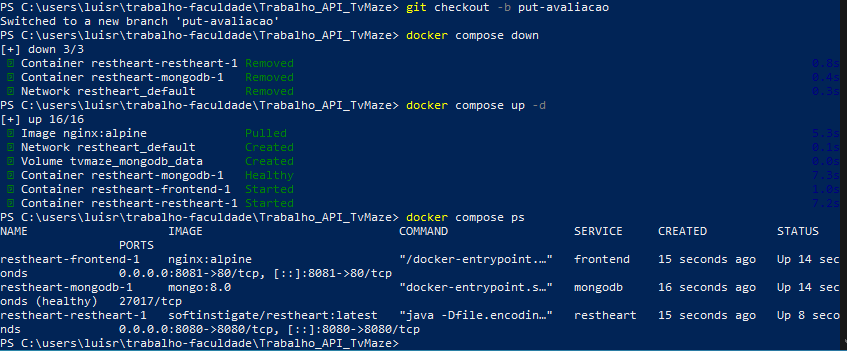
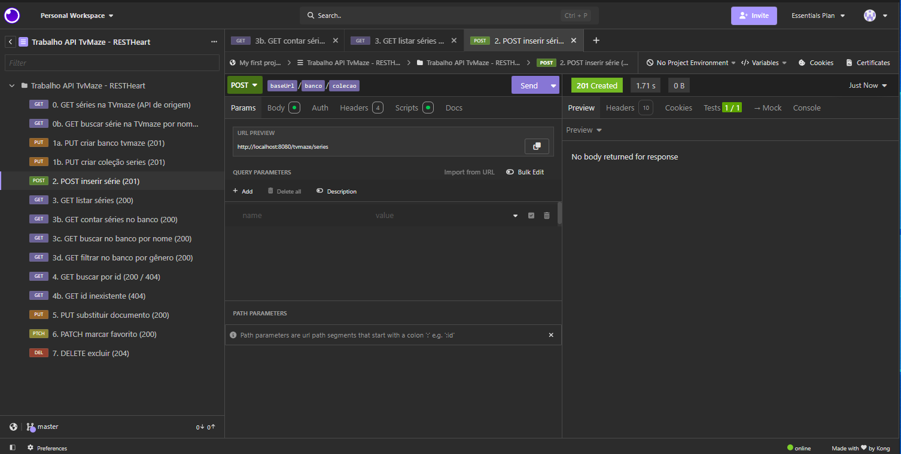
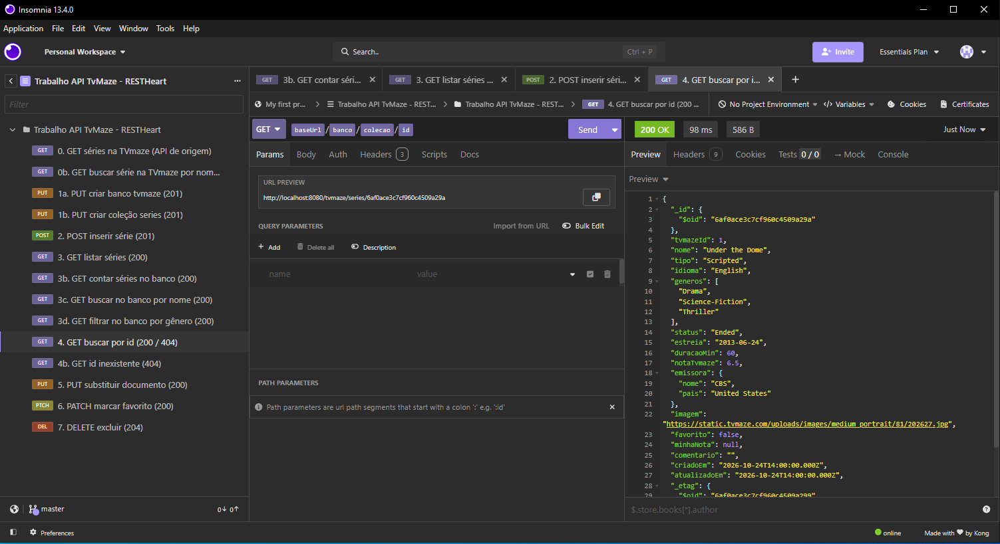
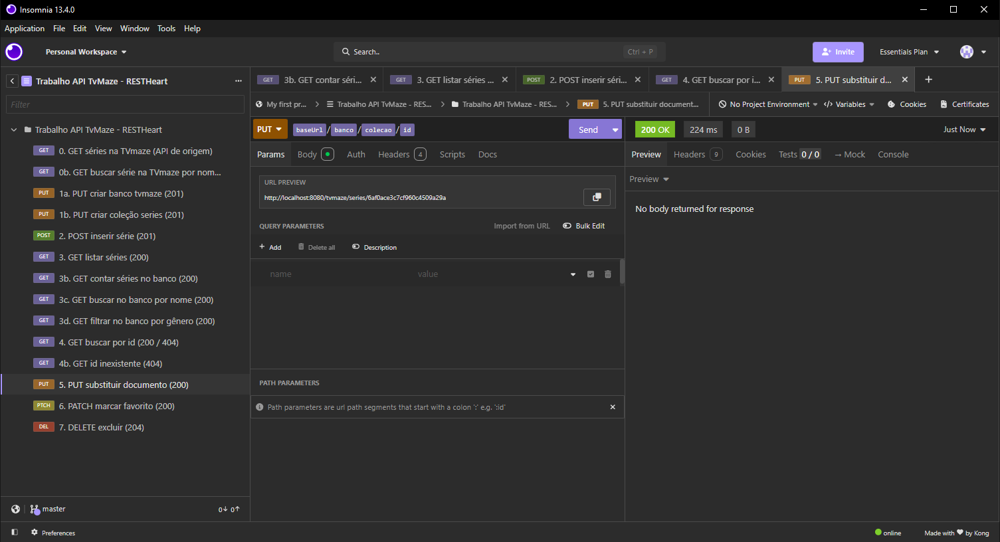
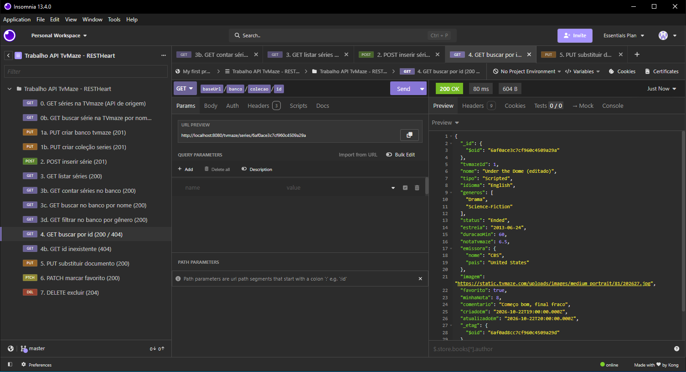
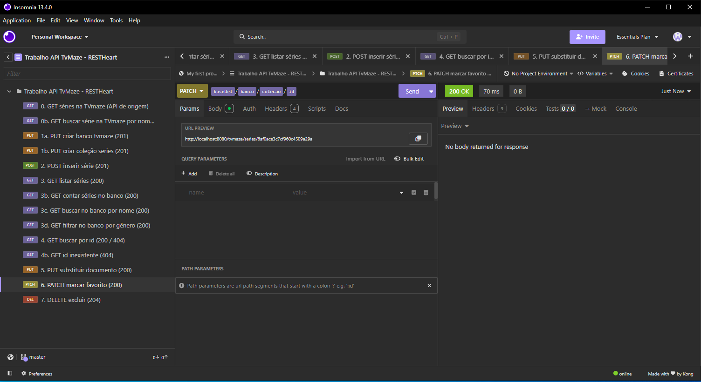
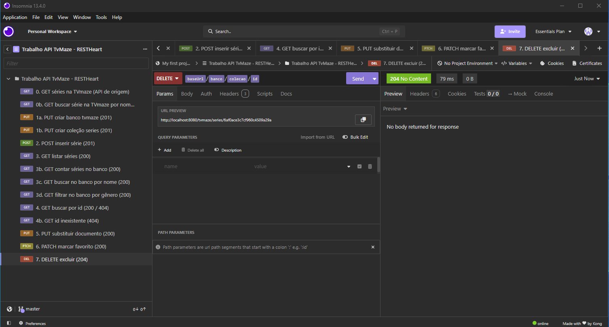
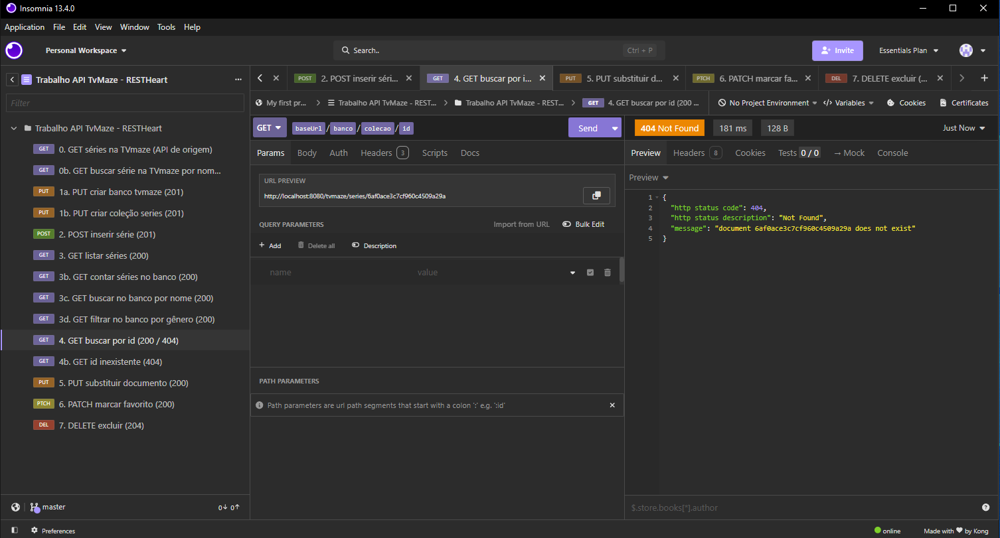
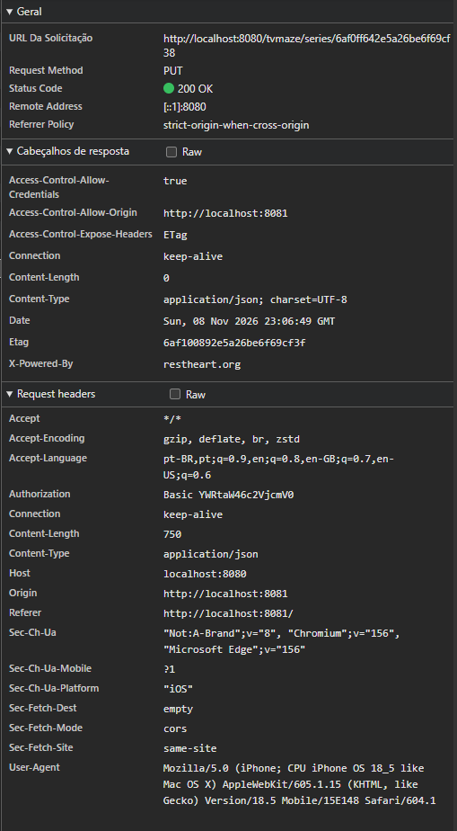
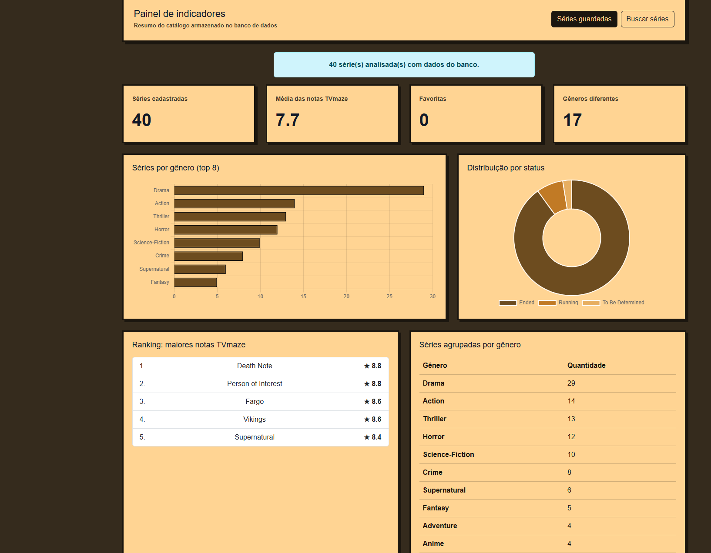

# Trabalho API TvMaze

**Site publicado:** https://gigasprogramante.github.io/Trabalho_API_TvMaze/

As modificações no arquivo README do projeto serão feitas na main puramente por conveniência, sabemos que não seria o ideal.

## Papéis definidos

- Guilherme Vojciechovski: Dados (Modelagem, Banco, Docker)
- Luis Ronei: API (Requisições HTTP e Insomnia)
- Henrique Mengarda: Interface (Frontend e gráficos)

## Tema e API de origem

- **Tema:** Séries de TV
- **API de origem:** [TVmaze](https://www.tvmaze.com/api), gratuita e sem chave. É usada só para leitura (GET): `https://api.tvmaze.com/shows?page=0` na importação e `https://api.tvmaze.com/search/shows?q={nome}` na busca do site.
- **Banco NoSQL:** MongoDB exposto como API REST pelo RESTHeart, os dois em Docker. Banco `tvmaze`, coleção `series`.

## Como executar o projeto localmente

O site também está no GitHub Pages (link no início), mas as páginas que usam o banco (séries guardadas, detalhes e painel) só funcionam com o Docker rodando na máquina, porque o MongoDB e o RESTHeart são locais. Por isso, os passos abaixo valem também para quem acessa pelo GitHub Pages.

O frontend, o RESTHeart e o MongoDB são iniciados juntos pelo Docker Compose. Não é necessário instalar ou executar o Live Server nem abrir os arquivos HTML diretamente.

1. Inicie o Docker Desktop e aguarde a engine ficar disponível.
2. No terminal, acesse a pasta raiz do repositório e suba os três serviços:

```bash
docker compose up -d
```

3. Confira se `frontend`, `restheart` e `mongodb` estão em execução:

```bash
docker compose ps
```

4. Abra **http://localhost:8081/** no navegador. Essa página é servida pelo Nginx no container `frontend`; as rotas também estão disponíveis em `/salvas.html`, `/painel.html` e `/detalhes.html?id={id}`.

O RESTHeart fica disponível em **http://localhost:8080/**. Na primeira execução, o site cria o banco e a coleção quando necessário. Para importar séries da TVmaze, execute na raiz do repositório, com o Docker em execução:

```bash
node js/importar.mjs
```

Não use `docker compose down -v` para apenas reiniciar o site: esse comando também apaga o volume de dados do MongoDB.

### Como conferir, parar e apagar o ambiente

```bash
docker compose ps                    # conferir frontend, restheart e mongodb
docker compose logs -f frontend      # ver logs do Nginx
docker compose logs -f restheart     # ver logs da API
docker compose stop                  # parar os containers (mantém os dados)
docker compose start                 # iniciar de novo
docker compose down                  # remover os containers (mantém o volume)
docker compose down -v               # remover containers e APAGAR o volume do MongoDB
```

Depois de `docker compose down -v`, suba os serviços novamente com `docker compose up -d` e rode `node js/importar.mjs` para recriar a coleção e popular o banco.

## Como enviar requisições ao banco

### Programa necessário

Para poder enviar requisições sem a necessidade de desenvolver o sistema precisamos utilizar um programa que permite enviar requisições diretamente, recomendo o [Insomnia](https://insomnia.rest/download).

### Como fazer uma requisição no Insomnia

Ao iniciar o programa, clique em **Send a request**, isso vai te levar à interface que permite enviar as requisições.

Nessa tela, clique em **Auth** abaixo do campo no qual inserimos o link para a requisição, agora, selecione **Inherit from parent** e altere para **Basic**, nessa tela, preencha as credencias da seguinte maneira:

>**USERNAME:** admin

>**PASSWORD:** secret

**Obs:** Logicamente as credenciais não serão essas no projeto final.

Agora, clique em **Headers**, e adicione um novo cabeçalho nomeado **Content-type** com o valor **application/json**, e pronto, agora é possível enviar requisições normalmente.

### Enviando uma requisição

Para testar, envie essa requisição para criar ou garantir o banco do projeto:

>**Método:** PUT

>**Link:** http://localhost:8080/tvmaze

Clique em **Send**. Um retorno **201** indica que o banco foi criado; se já existir, o RESTHeart pode retornar **200**.


>Tenha em mente que esse teste não é necessário caso você pretenda executar o teste completo descrito nas próximas seções.
>
## Modelo do documento JSON

Cada série é gravada como um documento na coleção `series`, dentro do banco `tvmaze`. O documento base de teste fica em [`testes/serie-exemplo.json`](testes/serie-exemplo.json):

```json
{
  "tvmazeId": 1,
  "nome": "Under the Dome",
  "tipo": "Scripted",
  "idioma": "English",
  "generos": ["Drama", "Science-Fiction", "Thriller"],
  "status": "Ended",
  "estreia": "2013-06-24",
  "duracaoMin": 60,
  "notaTvmaze": 6.5,
  "emissora": { "nome": "CBS", "pais": "United States" },
  "imagem": "https://static.tvmaze.com/uploads/images/medium_portrait/81/202627.jpg",
  "resumo": "Descrição indisponível.",
  "favorito": false,
  "minhaNota": null,
  "comentario": "",
  "criadoEm": "2026-10-24T14:00:00.000Z",
  "atualizadoEm": "2026-10-24T14:00:00.000Z"
}
```

| Campo | Tipo | Origem |
| --- | --- | --- |
| `tvmazeId`, `duracaoMin`, `notaTvmaze` | número | TVmaze (`id`, `runtime`, `rating.average`) |
| `nome`, `tipo`, `idioma`, `status`, `imagem` | texto | TVmaze |
| `estreia` | data | TVmaze (`premiered`) |
| `generos` | lista embutida | TVmaze (`genres`) |
| `emissora` | objeto embutido | TVmaze (`network` ou `webChannel`) |
| `resumo` | texto | TVmaze (`summary`, sem tags HTML) |
| `favorito`, `minhaNota`, `comentario`, `criadoEm`, `atualizadoEm` | campos do grupo | não existem na API |

### Embutido x referenciado

- **Embutidos:** `generos` (lista) e `emissora` (objeto) ficam dentro do documento da série. São dados pequenos, sempre lidos junto com a série (nos cards, na busca, no filtro por gênero e no agrupamento por emissora) e quase nunca mudam. Embutindo, uma única requisição GET traz tudo, sem precisar juntar coleções.
- **Referenciado:** `tvmazeId` é uma referência à série na API de origem. Elenco e episódios não são copiados para o banco, porque podem ser muitos e crescer com o tempo. Quando precisamos deles (na página de detalhes), buscamos na TVmaze pelo `tvmazeId`.
- **Campos do grupo:** `favorito`, `minhaNota`, `comentario`, `criadoEm` e `atualizadoEm` não existem na TVmaze e são alterados pelo PUT e pelo PATCH.

## Testando o banco com o JSON base

Com o ambiente rodando (`docker compose up -d`) e o Insomnia configurado como explicado acima (Auth **Basic** `admin`/`secret` e header `Content-Type: application/json`).

**Atenção à URL:** o nosso `docker-compose.yml` expõe todos os bancos do MongoDB na raiz, então a URL segue o formato `http://localhost:8080/{banco}/{coleção}`. O nosso banco é `tvmaze` e a coleção é `series`.

### 1. Criar o banco — PUT (201)

>**Método:** PUT

>**Link:** http://localhost:8080/tvmaze

### 2. Criar a coleção — PUT (201)

>**Método:** PUT

>**Link:** http://localhost:8080/tvmaze/series

Se o banco ou a coleção já existirem, o retorno é **200** em vez de 201, o que também está correto.

### 3. Inserir uma série — POST (201)

>**Método:** POST

>**Link:** http://localhost:8080/tvmaze/series

Em **Body**, escolha **JSON** e cole o conteúdo de `testes/serie-exemplo.json`. O retorno deve ser **201**, e o id do novo documento aparece no cabeçalho **Location** da resposta (aba *Headers*), no final do link.

### 4. Listar as séries — GET (200)

>**Método:** GET

>**Link:** http://localhost:8080/tvmaze/series?pagesize=100

O retorno deve ser **200**, com a lista contendo o documento inserido. Cada documento vem com um `_id` no formato `{ "$oid": "..." }`.

### 5. Buscar uma série pelo id — GET (200 / 404)

>**Método:** GET

>**Link:** http://localhost:8080/tvmaze/series/{id}

Troque `{id}` pelo valor do `$oid`. Com um id que não existe, o retorno é **404**.

### Coleção pronta para importar

Todas as requisições do projeto (incluindo PUT, PATCH e DELETE de documentos, usados nas próximas etapas) estão em [`insomnia/colecao.json`](insomnia/colecao.json). No Insomnia: **Import** → selecione o arquivo. A autenticação Basic já vem configurada, e a requisição de POST guarda automaticamente o id criado para as requisições seguintes.

## Importação dos dados (GET na TVmaze + POST no banco)

O script [`js/importar.mjs`](js/importar.mjs) faz a carga inicial da coleção:

1. **PUT** `/tvmaze` e **PUT** `/tvmaze/series`: garante que o banco e a coleção existem (201 na primeira vez, 200 se já existirem).
2. **GET** `https://api.tvmaze.com/shows?page=0`: busca as séries na API de origem (só leitura).
3. Converte cada série para o modelo de documento do grupo (seção "Modelo do documento JSON").
4. **POST** `/tvmaze/series` para cada série: grava o documento (201, com o id no cabeçalho `Location`).

O script não duplica séries: antes de gravar, ele lê do banco os `tvmazeId` que já existem e pula esses.

### Como rodar

Pré-requisito: [Node.js](https://nodejs.org) 18 ou mais novo (confira com `node --version`).

Com o ambiente rodando (`docker compose up -d`), na raiz do projeto:

```bash
node js/importar.mjs        # importa 40 séries
node js/importar.mjs 60     # ou outra quantidade
```

No final ele mostra quantas séries foram inseridas e o total no banco. Para conferir no Insomnia: `GET /tvmaze/series/_size` (200).

## Endpoints

Base do banco: `http://localhost:8080/tvmaze/series`, com autenticação Basic `admin`/`secret`.

| Ação | Método e URL | Status esperado |
| --- | --- | --- |
| Buscar séries na origem | `GET https://api.tvmaze.com/shows?page=0` | 200 |
| Buscar série na origem por nome | `GET https://api.tvmaze.com/search/shows?q={nome}` | 200 |
| Criar o banco | `PUT /tvmaze` | 201 (200 se já existir) |
| Criar a coleção | `PUT /tvmaze/series` | 201 (200 se já existir) |
| Inserir série | `POST /tvmaze/series` | 201 (id no cabeçalho `Location`) |
| Listar séries | `GET /tvmaze/series?pagesize=100` | 200 |
| Contar séries | `GET /tvmaze/series/_size` | 200 |
| Buscar por nome no banco | `GET /tvmaze/series?filter={"nome":{"$regex":"dome","$options":"i"}}` | 200 |
| Filtrar por gênero | `GET /tvmaze/series?filter={"generos":"Drama"}` | 200 |
| Buscar por id | `GET /tvmaze/series/{id}` | 200 ou 404 |
| Substituir série | `PUT /tvmaze/series/{id}` | 200 |
| Alterar campos | `PATCH /tvmaze/series/{id}` | 200 |
| Excluir série | `DELETE /tvmaze/series/{id}` | 204 |

**Atenção:** o RESTHeart devolve no máximo 100 documentos por página por padrão. Para listar tudo, use `?pagesize=1000` (ou `&page=2`, `&page=3`...).

Todas essas requisições estão na coleção [`insomnia/colecao.json`](insomnia/colecao.json).

## Testes de todos os métodos HTTP

Sequência testada no Insomnia, com a coleção `insomnia/colecao.json`. Ela cria uma série de teste e a exclui no final, então o banco não fica com duplicatas:

| Ordem | Requisição | Resultado |
| --- | --- | --- |
| 1 | `POST /tvmaze/series` | 201 Created (id no `Location`) |
| 2 | `GET /tvmaze/series/{id}` | 200 OK |
| 3 | `PUT /tvmaze/series/{id}` | 200 OK |
| 4 | `GET /tvmaze/series/{id}` | 200 OK, com os campos alterados pelo PUT |
| 5 | `PATCH /tvmaze/series/{id}` | 200 OK |
| 6 | `DELETE /tvmaze/series/{id}` | 204 No Content |
| 7 | `GET /tvmaze/series/{id}` | 404 Not Found (série excluída) |

No site, cada método também é usado: **POST** ao guardar uma série, **GET** na listagem, nos detalhes e no painel, **PUT** ao salvar a avaliação (nota e comentário, reenviando o documento inteiro), **PATCH** ao favoritar e **DELETE** ao remover do banco (com confirmação).

### Prints dos testes

**Ambiente: `docker compose ps` com os três serviços (frontend, restheart e mongodb)**


**1. POST: inserir série (201)**


**2. GET por id (200)**


**3. PUT: substituir documento (200)**


**4. GET depois do PUT (campos alterados)**


**5. PATCH: marcar favorito (200)**


**6. DELETE: excluir (204)**


**7. GET depois do DELETE (404)**


**8. PUT feito pelo site ao salvar a avaliação (200)**


## Painel de indicadores

Na página inicial, use o botão **Painel de indicadores**, ao lado de **Séries guardadas**, para abrir o painel. Ele consulta os documentos salvos no RESTHeart e exibe o total de séries, média das notas TVmaze, quantidade de favoritas, gêneros diferentes, gráficos por gênero e status, ranking das séries mais bem avaliadas e tabela de séries agrupadas por gênero.

Na página de detalhes de uma série, a seção **Minha avaliação** permite escolher uma nota de 0 a 10, em passos de 0,5, e escrever um comentário de até 2.000 caracteres. **Salvar avaliação** grava os campos `minhaNota`, `comentario` e `atualizadoEm` no documento do MongoDB; os valores já existentes são carregados para edição.

Para apagar um título e todos os seus dados pessoais do MongoDB, use **Remover do banco** no card da página de séries guardadas ou nos detalhes da série e confirme a ação. Essa exclusão remove apenas o documento local; a série continua existindo na TVmaze.

### Conclusão tirada dos dados



Com as 40 séries importadas, o painel mostra que **Drama domina o catálogo**: o gênero aparece em 29 das 40 séries (cerca de 73%), muito à frente de Action (14), Thriller (13) e Horror (12). Como cada série tem vários gêneros, Drama costuma vir combinado com suspense, terror ou ficção científica. A **média das notas TVmaze é alta (7,7)**, e o ranking é bem variado: Death Note e Person of Interest empatam no topo com 8,8, seguidas de Fargo e Vikings (8,6) e Supernatural (8,4), ou seja, as séries mais bem avaliadas não se concentram em um só gênero. Por fim, **quase todas as séries já foram encerradas** (status *Ended*). Isso acontece porque a importação traz a primeira página do catálogo da TVmaze, com as séries mais antigas cadastradas na API. Para analisar lançamentos recentes, o próximo passo seria importar outras páginas (`/shows?page=N`).

## Uso de IA

Conforme pedido no enunciado, registramos onde ferramentas de IA foram usadas:

- **No geral:** rascunho do JSON de teste (`testes/serie-exemplo.json`), da coleção do Insomnia (`insomnia/colecao.json`), do script de importação (`js/importar.mjs`) e de partes deste README (modelo do documento, testes, importação e endpoints). Todo o código foi revisado e testado pelo grupo.
- Auxilio foi utilizado no projeto como um todo visto a complexidade do projeto somado a nossa ingenuidade. Porém ela foi mais necessária ao fim do desenvolvimento para analisar possiveis erros, revisar o projeto todo, adicionar comentário que facilitam a leitura do código, a implementação do front via nginx no docker, que teve alguns problemas, e por fim, auxiliar em questões de hospedagem do site, que ainda estamos analisando
